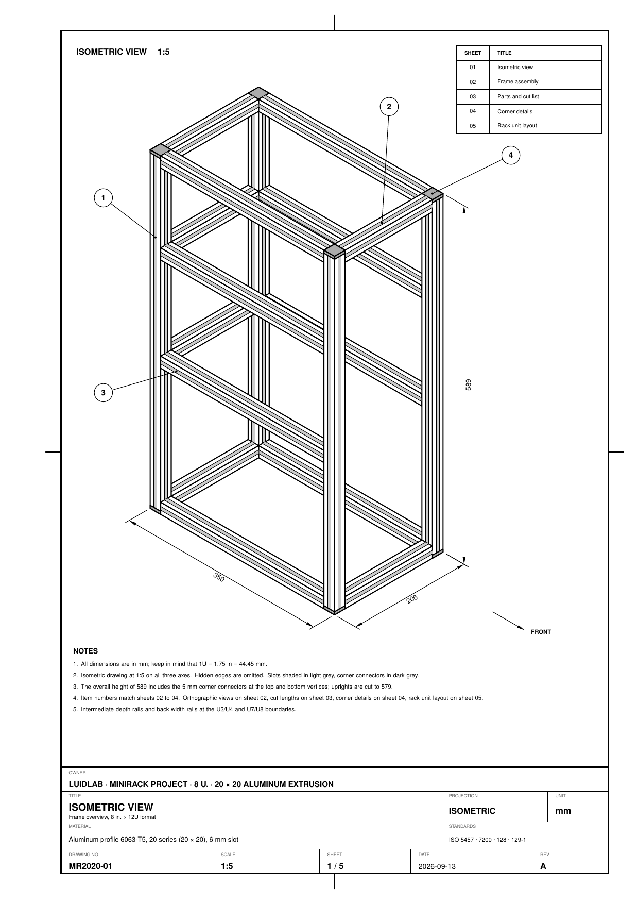
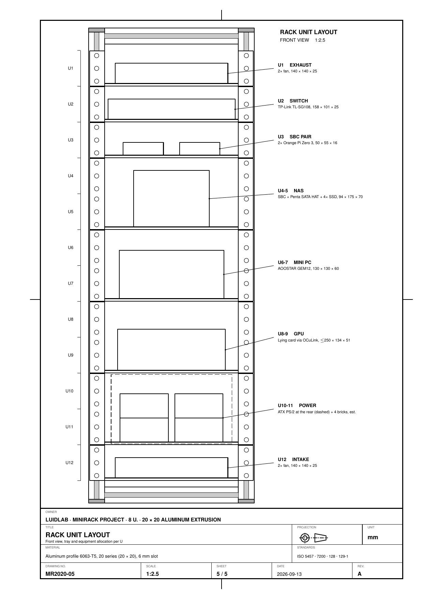

# LuidLab

A homelab with an 8 in. × 12U minirack built from 2020 aluminum extrusions and some shit hardware.

<p align="center">
  
  
</p>
<p align="center"><sub>Isometric view (MR2020-01) and rack unit layout (MR2020-05). Full drawing set in <code>rack/desenhos/mr2020.pdf</code>.</sub></p>

## Hardware

- **Mini PC:** AOOSTAR GEM12 (Ryzen 7 8845HS), with OCuLink
- **GPU:** mid-size card over OCuLink (planned)
- **NAS:** Raspberry Pi 5 or Radxa ROCK, Radxa Penta SATA HAT, 4× 2.5" SATA SSD
- **SBCs:** 2× Orange Pi Zero 3
- **Network:** TP-Link TL-SG108, 8-port Gigabit switch
- **Power and cooling:** ATX PS/2 PSU, 4× 140 mm fans, acrylic side panels

## Repository layout

```
coisas               project notes
rack/
├── README.md        frame summary, cut list and unit layout
├── img/             drawing sheets rendered for the READMEs
└── desenhos/        MR2020 technical drawing set, LaTeX
```

## Drawings

The drawing set lives in `rack/desenhos/` and builds into a single PDF, `mr2020.pdf`.
Every frame dimension comes from `params.tex`.

Requirements: TeX Live (pdflatex with TikZ), Poppler (`pdftoppm`) and `make`.

```sh
cd rack/desenhos
make          # builds mr2020.pdf, running pdflatex twice
make imagens  # renders sheets 01 and 05 into rack/img/ for the READMEs
make limpa    # removes auxiliary files
```
